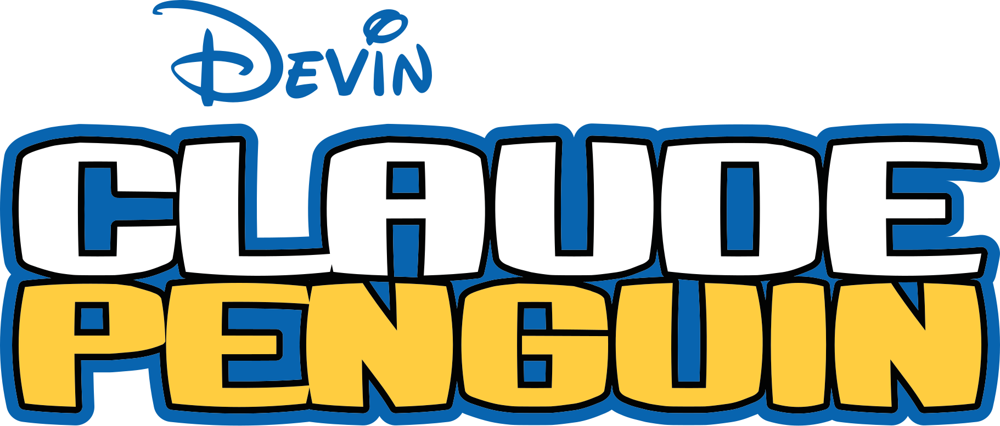

<div align="center">



# Claude Penguin

### A fan-made recreation of **Club Penguin** that runs entirely in your browser: no Flash, no plugins, no installs.


[](https://claudepenguin.mooo.com)

</div>

---

## About

**Claude Penguin** is a Brazilian fan project by **[Arenovisk](https://github.com/gabixou)** that reimagines the classic Club Penguin experience as a modern web game. Walk through snowy villages, cozy coffee shops and lively dance floors rendered with the **original vector assets** — Flash timelines, SVG shapes and paperdoll sprites — running smoothly in any modern browser.

It is a love letter to the penguin that stole our childhoods: authentic HUD, real game assets, chat, rooms, outfits, catalogues, minigames and a multiplayer world rebuilt from scratch for the web.

## Features

- 🎬 **Authentic vector renderer** — a JavaScript port of the GoPenguin `MovieRoom` engine: parses the original SWF-derived timelines (`timelines.json` + packed SVGs) and replays the real display lists, buttons (`up`/`over`/`down`), masked layers and animated overlays — rooms like the Nightclub with its DISCO sign, disco ball and dance floor.
- 🐧 **True paperdoll penguins** — multi-part clothing rendered from the original character packs with Flash `colorTransform` tinting (in Web Workers), 8-way walk animation, emotes, sitting and remote-player action sync.
- 🖥️ **Classic web HUD** — chat bar, action bar, island map, player cards, inventory/wardrobe (owned items only) and time-accurate catalogues with purchase confirmations.
- 🌐 **Multiplayer** — real-time rooms over WebSocket: movement, chat, emotes, equipment changes and multiple simultaneous rooms.
- 🎮 **Minigames** — Pufflescape and other bundled minigames via native overlays.
- ⚡ **Heavily optimized loading** — shared asset caches, IndexedDB layer/bitmap cache (warm room entry in ~0.4s revisits, ~2–4s between sessions), parallel render lanes, Web Worker tinting and idle pack prefetch for all rooms.
- 🧪 **Dev tools** — `?penguin=Arenovisk` test penguin (loopback only), deterministic QA probes and visual regression pipeline.

## How it differs from CPPs (Club Penguin Private Servers)

Most Club Penguin private servers are **emulators of the original Flash client**: they re-host the dead `.swf` files and reimplement the network protocol (Houdini, Timeline, Kitsune, etc.). They require Flash emulators like Ruffle, server stacks like Wand/Docker, and heavy backends like PostgreSQL.

**Claude Penguin takes a completely different approach:**

| | CPPs (Flash emulators) | Claude Penguin |
|---|---|---|
| **Client** | Original `.swf` files via Flash emulator (Ruffle) | Native JavaScript/Phaser 3 — zero Flash dependency |
| **Rendering** | Adobe Flash Player (dead tech) | WebGL via Phaser 3 + custom vector renderer |
| **Server** | Python/Perl/Ruby protocol emulators + databases | Lightweight Node.js WebSocket server (`ws`) + SQLite |
| **Setup** | Docker, PostgreSQL, Nginx, websockify bridges | `npm install` → `npm start`, or one `.bat` on Windows |
| **Scenes** | SWF timelines | Parsed SWF timelines + packed SVG assets (GoPenguin pipeline) |

In short: instead of resurrecting Flash, this project **rebuilds the game natively for the web**: same soul, modern bones.

## Tech stack

**Client** (`client/`)
- [Phaser 3](https://phaser.io/) — 2D game engine (WebGL/Canvas)
- [Vite](https://vitejs.dev/) — dev server & bundler
- Custom `MovieRoom`/`Clip` renderer — Flash display-list/timeline port
- Web Workers — manifest parsing and pixel tinting
- `createImageBitmap` + OffscreenCanvas — async SVG rasterization
- IndexedDB — pack and rasterized-layer caches
- Pure JavaScript, ES modules

**Server** (`server/`)
- [Node.js](https://nodejs.org/) + [`ws`](https://github.com/websockets/ws) — WebSocket multiplayer server
- SQLite via `better-sqlite3` — player persistence

**Tooling** (local, not in repo)
- Playwright — automated browser QA probes
- Gemini Vision / local Ollama models — visual regression analysis

## Getting started

```bash
# 1. Server (WebSocket on port 8080)
cd server
npm install
npm start

# 2. Client — production build + preview (port 3000), in another terminal
cd client
npm install
npm run build
npx vite preview --port 3000
```

Then open **http://localhost:3000** in your browser.

On Windows, **`INICIAR_JOGO.bat`** automates the whole flow (deps check → production build → server + preview → opens the browser). For development with hot-reload, run `npm run dev` in `client/` instead of the build+preview step.

## Built with AI

This project was created almost entirely with **AI coding agents** running for free:

- 🤖 **[Devin](https://devin.ai)** — developed on the free promotional plan powered by **SWE-2 Flash Medium**
- 🦙 **[Ollama](https://ollama.com/)** with local Qwen models for heavy lifting
- 👁️ **Gemini Vision** — validates every visual change by comparing screenshots against the reference implementation

A real-world experiment in what a solo developer + free AI tools can build.

## Disclaimer

Claude Penguin is a **non-commercial fan project**. It is **not affiliated with, endorsed by, or related to Disney, Club Penguin, or Miniclip** in any way. All Club Penguin assets, names and trademarks belong to their respective owners. This project exists for preservation and educational purposes.

## Credits

- 🐧 **[solero/wand](https://github.com/solero/wand)** — the Docker-based CPP stack that inspired the multiplayer architecture research
- 🕹️ **[Tweebbo/gopenguin-3ds](https://github.com/Tweebbo/gopenguin-3ds)** — GoPenguin for Nintendo 3DS, proof that the Club Penguin spirit lives on across platforms
- 🎮 **[gopenguin.lol](https://gopenguin.lol)** — the reference implementation used for visual parity QA and the asset pipeline this client is built on
- 🙏 The entire Club Penguin private server community, for keeping the penguins sliding since 2017

---

<div align="center">
  <sub>Feito com 🐧 e muito café: um projeto brasileiro de <a href="https://github.com/gabixou">Arenovisk</a></sub>
</div>
